# TalentSol — AI-Powered Applicant Tracking System

MVP SaaS applicant tracking system, built as a learning project and not deployed for real hiring. It has JWT authentication, company scoped data for normal JWT requests, Stripe subscription billing, and an integrated XGBoost model for candidate screening. A fixed demo token bypasses normal authentication and company scoping.

> **Important: the screening model uses Ethnicity.** The saved XGBoost model one hot encodes an Ethnicity column as an input. The Ethnicity values in its training data are mostly national origin labels, such as Chinese, Irish and Nigerian. Using this input to screen candidates is not acceptable for real hiring. I plan to retrain the model without Ethnicity, Race1 and Race2. Race1 and Race2 are already excluded from the saved model. The reported metrics must be measured again after retraining. See [ML Model Details](#ml-model-details) and [Fairness](#fairness).

---

## Recent Update — UI Overhaul & SaaS Productization with Claude Code

The TalentSol project grew from my learning reflections in Cornell University's [eCornell "Designing and Building AI Solutions"](https://ecornell.cornell.edu/certificates/ai/designing-and-building-ai-solutions/) program. I built the original application, including the ML pipeline, app logic, and frontend, with [Augment Code](https://www.augmentcode.com/) Agent. I later used Anthropic's [Claude Code](https://docs.anthropic.com/en/docs/claude-code) terminal interface to revise the user interface and SaaS features. For full project context, see my earlier articles in the [Core AI newsletter](https://www.linkedin.com/newsletters/7332966495557230592/).

My role during the user interface overhaul was **product owner, context engineer and system designer**, with Claude Code serving as pair programmer. I defined the objectives, interface guidelines, product requirements, architecture, and system design. I maintained project instructions across sessions. The message of commit `889cf25` records **125 tasks across 24 phases** for the user interface overhaul and SaaS productization.

### Workflow

The overhaul followed a structured but adaptive workflow:

- **UI and frontend implementation** — I directed and reviewed all interface changes that Claude Code generated against my architectural vision and product requirements.
- **Backlog documentation** — After each phase, I updated a dedicated overhaul document with full details of completed tasks to maintain a traceable record of progress.
- **Quality assurance and context management** — Between each major phase, I ran multiple test types, updated error handling, refined the project guidelines as harnesses, and compacted context to maintain Claude Code's coherence for the next phase.
- **Replanning** — I built a new plan for each subsequent phase based on test results and remaining objectives.
- **Unified data schema with synthetic data generation** — I directed the data layer redesign with seeded synthetic data to ensure reproducibility across development environments.
- **Business logic, functions, webhooks and other dependencies** — I reviewed and approved updates to application business logic, backend functions, and webhook handlers that Claude Code proposed against my system design.
- **Final refactoring** — I directed the cleanup pass to remove redundant scripts and consolidate the codebase.

Even though I am Agile Scrum certified, my workflow did not follow traditional Waterfall or Agile Scrum methodologies. The speed and flexibility of working with Claude Code enabled a tighter iteration loop than conventional sprint cycles would permit. Each phase concluded with a quality gate before replanning, creating a pragmatic cycle of **plan → implement → test → replan** that adapted organically to the project's needs.

### Key Lessons

Working with Claude Code as a pair programmer reinforced three hypotheses:

1. **Precise direction produces clean implementation** — Directing an AI coding agent is its own skill. Vague direction produces vague output. Precise written requirements produce clean implementation.
2. **Context management matters more than prompting** — You must maintain a clear mental model of what the agent knows and what it needs to be reminded of. That discipline mirrored my own architectural thinking. You need to update plans and nuanced instructions for every phase — not change guidelines based on intuition alone, or risk propagating unintended drift across your entire system design.
3. **Speed compounds from domain knowledge:** The pace of this overhaul depended on what I already knew about the codebase, software architectures, and system design fundamentals. I built the ML pipeline and designed the app logic using Augment Code before directing Claude Code. Knowing what good output looks like is a prerequisite for working at speed.

### XGBoost Integration

The TalentSol application integrates the XGBoost model that I selected from my prior model building projects. Those projects compared 22 models across two repositories: 16 decision tree and ensemble classifiers, and 6 logistic regression classifiers. The application wraps the model in an MVP interface with a machine learning data pipeline. The model still uses Ethnicity as an input, as described in [ML Model Details](#ml-model-details). My Core AI article [Adversarial Attacks and the Interpretability Tradeoff](https://thecoreai.substack.com/p/neural-network-architectures-part3) discusses adversarial robustness for systems that process external input.

### Related Repositories

- [TalentSol Applicant Tracking System Application](https://github.com/youshen-lim/TalentSol---Applicant-Tracking-System-Application) — this repository
- [TalentSol Supervised Classifier for Initial Candidate Screening with Decision Trees](https://github.com/youshen-lim/TalentSol_Supervised-Classifier-for-Initial-Candidate-Screening-Decision-Trees)
- [TalentSol Supervised Classifier for Initial Candidate Screening with Regression](https://github.com/youshen-lim/TalentSol-ATS-Supervised-Classifier-for-Initial-Candidate-Screening-and-Prioritization-Regression)

---

## Features

### Core ATS
- **Jobs** — create, edit, publish job listings with department, salary, requirements, and pipeline tracking
- **Candidates** — kanban pipeline view (Applied → Screening → Interview → Offer → Hired), candidate profiles with scoring
- **Applications** — full application management with stage progression and status history
- **Interviews** — schedule and track interviews with calendar view, interviewers, and feedback
- **Analytics** — source effectiveness, pipeline metrics, time-to-hire, custom reports with recharts visualisations
- **Documents** — document management and candidate file tracking

### SaaS Infrastructure
- **Authentication** — JWT-based login/register, email verification stubs, team invite flow
- **Multi-tenancy:** Data models carry a `companyId` column for row level isolation. Normal JWT requests are scoped to the company of the signed in user. A fixed demo token bypasses this check in any environment. See [Limitations](#limitations).
- **Subscription billing** — Stripe Checkout + Customer Portal; webhook-driven plan updates
- **Plan enforcement** — per-plan job and user limits enforced server-side across Trial, Starter, Growth, and Enterprise tiers

### AI / ML
- **XGBoost candidate screening:** The app integrates `best_performing_model_pipeline.joblib`. The training notebook reports out of fold recall 0.700 and precision 0.569 at threshold 0.5027. These numbers come from the Kaggle training data, not from TalentSol applications. The model uses Ethnicity as an input. See [ML Model Details](#ml-model-details).
- **Feature engineering:** The saved pipeline applies HashingVectorizer and one hot encoding. The ATS Ethnicity and Job Roles values often fall outside the categories the model learned. See [Limitations](#limitations).
- **Real-time predictions** — inference results delivered via WebSocket (Socket.io)
- **Batch processing:** The app scores applications asynchronously with retry logic.

---

## Screenshots

| | |
|---|---|
| 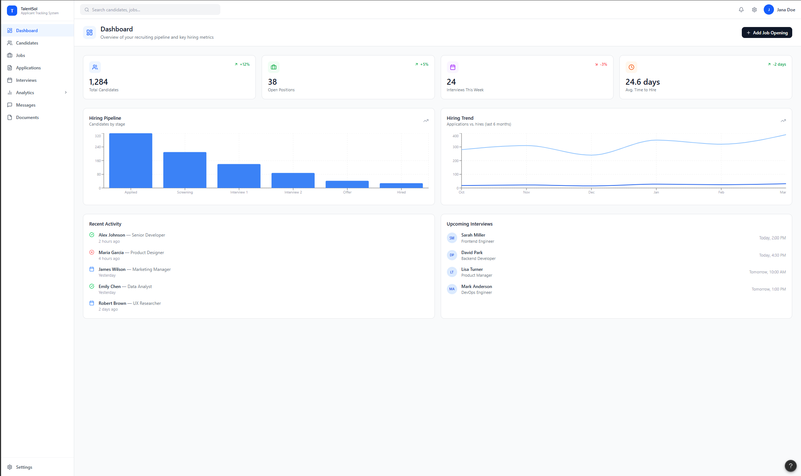 | 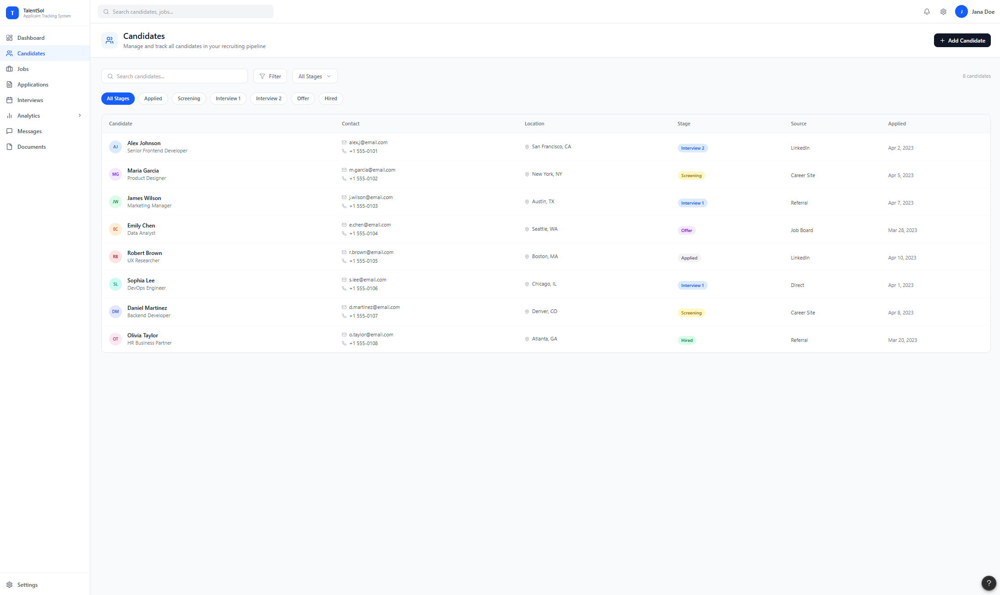 |
| **Dashboard** — pipeline stats, hiring trend, upcoming interviews | **Candidates** — stage pipeline with filters and scoring |
| 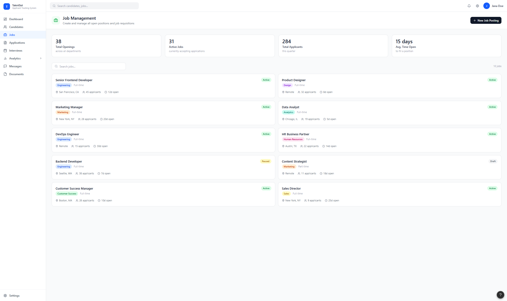 | 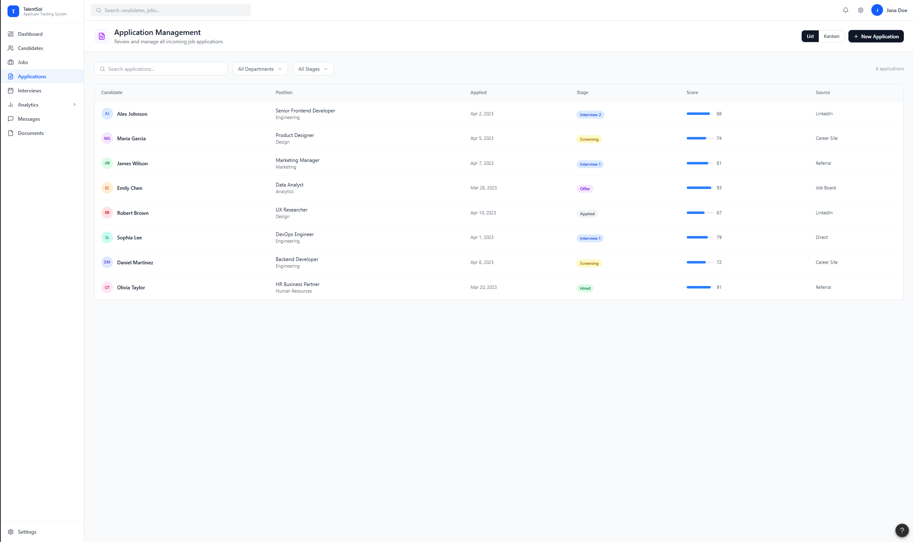 |
| **Jobs** — job listings with applicant counts and status | **Applications** — application management with ML scores |
| 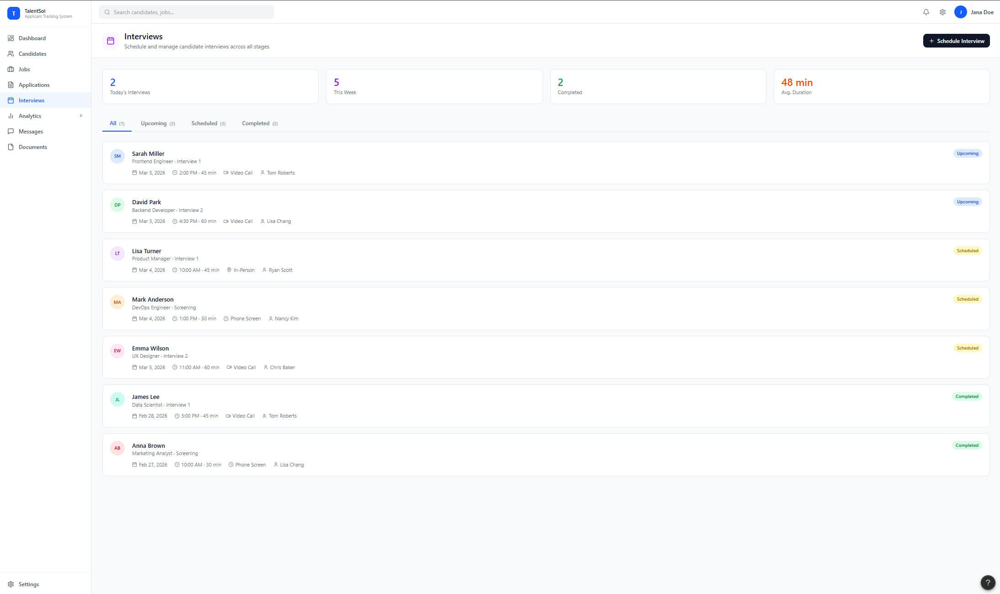 | 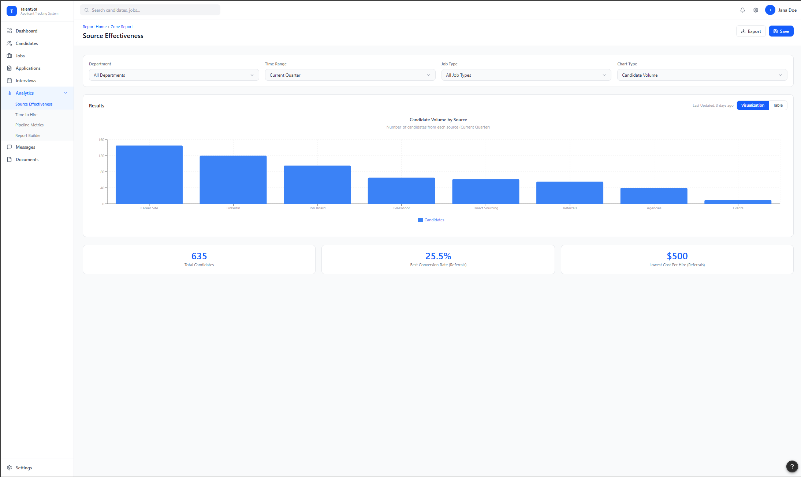 |
| **Interviews** — schedule and track across all stages | **Analytics** — source effectiveness by candidate volume |
| 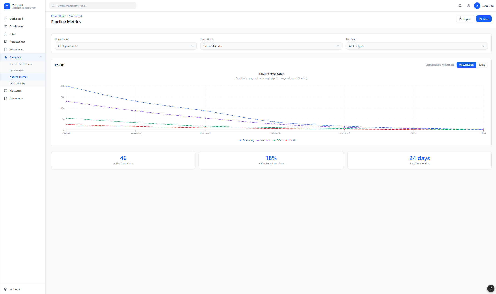 | 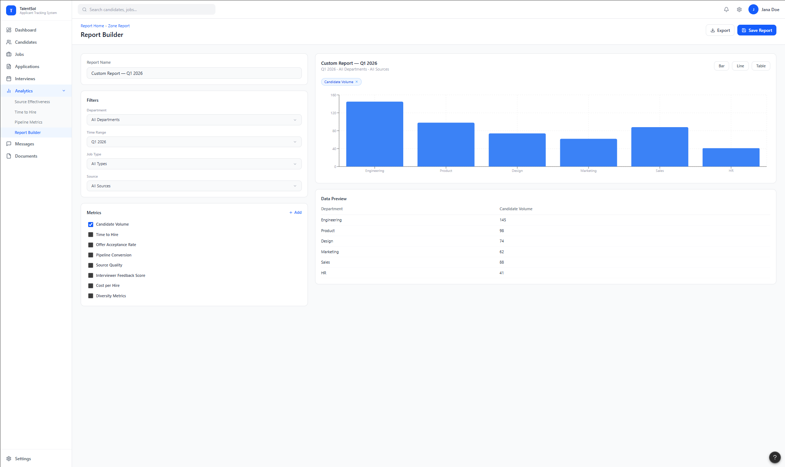 |
| **Analytics** — pipeline progression chart | **Analytics** — custom report builder |
| 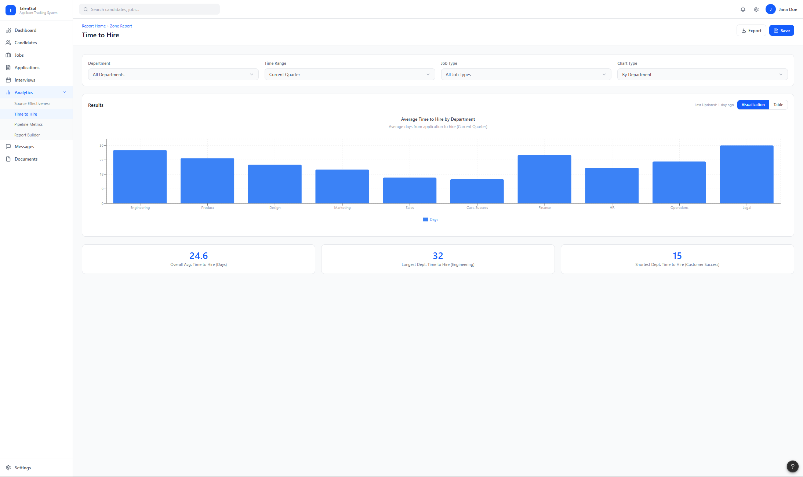 | 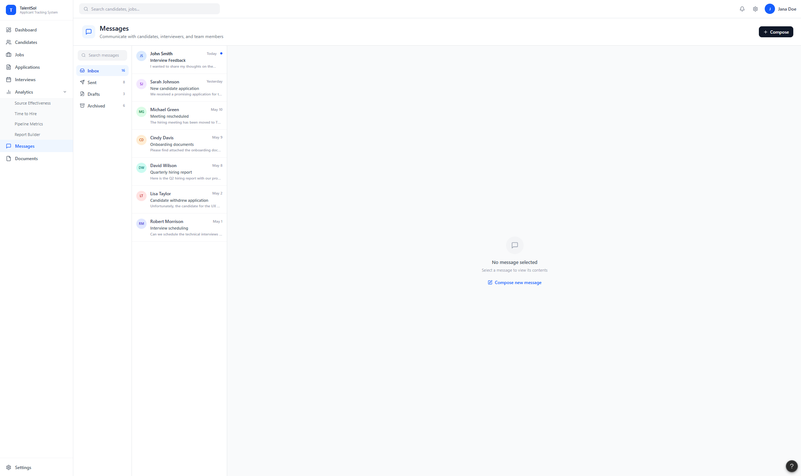 |
| **Analytics** — time to hire by department | **Messages** — team and candidate communication |
| 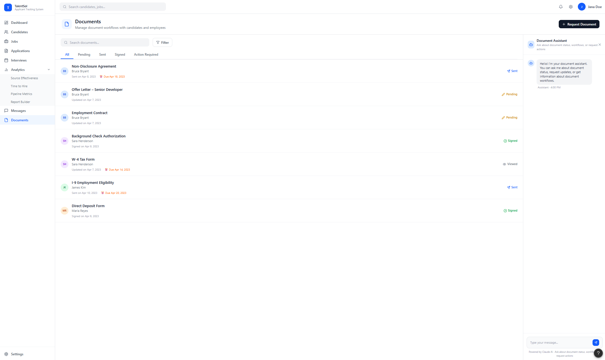 | 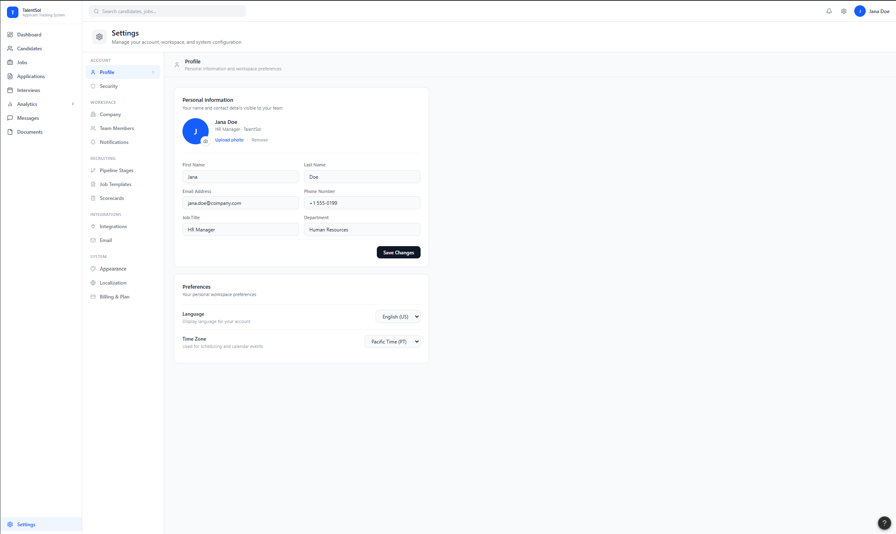 |
| **Documents** — document workflows with AI assistant | **Settings** — profile and workspace configuration |

---

## Tech Stack

| Layer | Technology |
|-------|------------|
| Frontend | React 18 + TypeScript + Vite + Tailwind CSS v4 |
| State | Zustand v5 + TanStack Query v5 |
| UI | shadcn/ui + Radix UI + Lucide icons + Recharts |
| Backend | Node.js (the backend declares 18 or later) + Express + TypeScript (ESM) |
| ORM | Prisma 5.7.1 |
| Database | PostgreSQL |
| Auth | JWT (jsonwebtoken + bcryptjs) |
| Billing | Stripe (subscriptions + webhooks) |
| ML | Python (the ML requirements file lists Python 3.13 as tested) · scikit-learn 1.6.1 · joblib 1.3.2 · XGBoost |
| Real-time | Socket.io (WebSocket, port 9001) |
| Cache | Redis (optional) · in-memory fallback |

---

## Project Structure

```
TalentSol/
├── src/                        # Frontend (React + Vite)
│   ├── pages/                  # Route-level page components
│   ├── components/             # Shared UI components
│   ├── hooks/                  # Data-fetching hooks (TanStack Query)
│   ├── services/               # API client (api.ts)
│   └── store/                  # Zustand state slices
├── backend/
│   ├── src/
│   │   ├── routes/             # Express route handlers
│   │   ├── middleware/         # Auth, plan enforcement, tenancy, rate limiting
│   │   ├── services/           # Business logic + ML integration
│   │   ├── cache/              # Redis + in-memory cache strategies
│   │   └── websocket/          # Socket.io server
│   ├── prisma/
│   │   └── schema.prisma       # Database schema
│   └── ml-models/              # XGBoost model + Python wrapper
├── public/                     # Static assets
└── docs/                       # Additional documentation
```

---

## Quick Start

### Prerequisites
- Node.js 18 or later (from the backend `engines` field)
- PostgreSQL
- Python with pip (for ML features; the ML requirements file lists Python 3.13 as tested)

### 1. Clone and install

```bash
git clone https://github.com/youshen-lim/TalentSol---Applicant-Tracking-System-Application.git
cd TalentSol---Applicant-Tracking-System-Application

# Frontend dependencies
npm install

# Backend dependencies
cd backend && npm install && cd ..
```

### 2. Configure environment

```bash
cp backend/.env.example backend/.env
# Edit backend/.env — set DATABASE_URL and JWT_SECRET at minimum
```

### 3. Set up the database

```bash
cd backend
npx prisma db push          # Apply schema to PostgreSQL
npm run db:seed             # Seed with demo data
cd ..
```

### 4. Run the app

Open two terminals:

```bash
# Terminal 1 — Frontend (port 5173)
npm run dev

# Terminal 2 — Backend (port 3001)
cd backend && npm run dev
```

Visit `http://localhost:5173` and log in with:
- **Admin:** `admin@talentsol-demo.com` / `password123`
- **Recruiter:** `recruiter@talentsol-demo.com` / `password123`

---

## Environment Variables

See [`backend/.env.example`](backend/.env.example) for the full reference. Minimum required:

| Variable | Required | Description |
|----------|----------|-------------|
| `DATABASE_URL` | ✅ | PostgreSQL connection string |
| `JWT_SECRET` | ✅ | Secret for signing JWT tokens |
| `PORT` | — | Backend port (default: `3001`) |
| `APP_URL` | — | Frontend URL for redirects (default: `http://localhost:5173`) |
| `STRIPE_SECRET_KEY` | Billing | Stripe secret key |
| `STRIPE_WEBHOOK_SECRET` | Billing | Stripe webhook signing secret |
| `STRIPE_PRICE_*` | Billing | Stripe Price IDs (one per subscription tier) |

Billing routes return `503` gracefully when Stripe vars are absent — the rest of the app works without them.

---

## API Endpoints

| Method | Endpoint | Auth | Description |
|--------|----------|------|-------------|
| POST | `/api/auth/register` | Public | Create account + company (14-day trial) |
| POST | `/api/auth/login` | Public | Login → JWT |
| GET | `/api/auth/verify-email` | Public | Verify email token |
| POST | `/api/auth/accept-invite` | Public | Accept team invite |
| GET | `/api/jobs` | Optional | Public job listings |
| POST | `/api/jobs` | Required | Create job (plan limit enforced) |
| GET | `/api/candidates` | Required | Candidates for company |
| GET | `/api/applications` | Required | Applications with candidate + job |
| GET | `/api/interviews` | Required | Interviews with candidate info |
| GET | `/api/analytics/dashboard` | Required | Aggregated stats |
| GET | `/api/billing/subscription` | Admin | Current plan + usage |
| POST | `/api/billing/create-checkout` | Admin | Start Stripe Checkout |
| POST | `/api/billing/create-portal` | Admin | Open Stripe Customer Portal |
| POST | `/api/billing/webhook` | Stripe | Webhook event handler |
| POST | `/api/users/invite` | Admin | Invite team member (plan limit enforced) |
| POST | `/api/xgboost/predict/:applicationId` | Required | Score one application with the XGBoost model |

"Required" means the route expects a bearer token. The backend also accepts a fixed demo token in place of a JWT in any environment. See [Limitations](#limitations).

---

## Deployment

### Frontend → Vercel

1. Connect repo to Vercel
2. Build command: `npm run build`, output: `dist`
3. Add env var: `VITE_API_URL=https://your-backend-host/api`

### Backend → Railway / Render / Fly.io

The backend requires a **persistent host** (not serverless) due to WebSocket and in-process scheduler. Steps:

1. Set all required env vars on the host
2. Update CORS origins in `backend/src/index.ts` to include your production frontend domain
3. Point `DATABASE_URL` to a hosted PostgreSQL instance (Neon, Railway, Supabase)

These steps describe how to host the app for a demo. Do not use the app for real hiring decisions. See [Limitations](#limitations).

---

## MVP Status

### Completed Phases

| Phase | Description |
|-------|-------------|
| UI Overhaul | Tailwind CSS v4 redesign of all 13 routed application pages |
| Demo Fixes | WebSocket port, analytics endpoints, multi-series recruitment chart |
| Real Authentication | JWT login/register, PrivateRoute guards, Zustand auth state |
| Multi-Tenancy | `companyId` row level isolation for JWT requests; a demo token bypass still works in any environment |
| Organisation Onboarding | Company registration, 14-day trial, email verification stubs, team invites |
| Stripe Billing | Checkout, Customer Portal, webhooks, plan enforcement middleware |
| XGBoost ML | Model integration, feature pipeline, real-time WebSocket predictions |

### Deferred (Post-MVP)

| Phase | Description |
|-------|-------------|
| File Storage | Cloudflare R2 for resume/document uploads |
| Transactional Email | Resend integration for verification, invites, stage-change notifications |
| Public Careers Page | Per-org `/careers/:slug` job board |
| RBAC | Fine-grained role permissions (admin / recruiter / hiring manager / interviewer) |
| Production Readiness | Docker, CI/CD, Sentry error monitoring, per-org rate limiting |
| Model retraining | Retrain the screening model without Ethnicity, Race1 and Race2, and measure the metrics again |
| Ethnicity removal in the app | Stop sending Ethnicity from the ATS feature pipeline to the model |

---

## ML Model Details

The integrated XGBoost model (`backend/ml-models/decision-tree/best_performing_model_pipeline.joblib`) was trained for automated candidate screening:

- **Architecture:** XGBoost Decision Tree Ensemble
- **Input:** Job Description, Resume, Job Roles and Ethnicity.
- **Preprocessing:** HashingVectorizer on Job Description and Resume. One hot encoding on Ethnicity and Job Roles.
- **Dependencies:** `scikit-learn==1.6.1`, `joblib==1.3.2`
- **Performance (from the training notebook):** out of fold recall 0.700 and precision 0.569 at threshold 0.5027.

**Ethnicity is an input to the current model.** The saved model one hot encodes Ethnicity. Its training data holds 21 Ethnicity values. Nineteen are national origin labels, such as Chinese, Irish and Nigerian. Two are regional labels: African and Caribbean. National origin is a protected characteristic in US hiring. Using this input to screen candidates is not acceptable for real hiring. I have not retrained the model yet. I plan to retrain it without Ethnicity, Race1 and Race2, and keep every other setting the same so the comparison is fair. Race1 and Race2 are already excluded from the saved model. I also plan to stop the ATS from sending Ethnicity to the model.

**How to read the metrics.** The out of fold recall 0.700 and precision 0.569 come from the Kaggle training data. The notebook tuned the threshold of 0.5027 on out of fold predictions from the training split. On the 20 percent test split, the notebook reports recall 0.703 and precision 0.567. I drew that test split after oversampling, so some test rows duplicate training rows. The test results are likely optimistic. The numbers were not measured on TalentSol application data. The metrics must be measured again after retraining without Ethnicity.

See [`docs/XGBOOST_IMPLEMENTATION_GUIDE.md`](docs/XGBOOST_IMPLEMENTATION_GUIDE.md) for full integration details. That guide still describes Ethnicity as a model input. Its production ready claim was corrected on November 20, 2026.

### Why I am removing protected attributes from the model

I decided that protected characteristics must not be inputs to a screening model. This covers ethnicity, race, national origin, age and gender. This is a place where human judgment should override a model. A model can find a statistical signal in any column. That signal does not make the column a fair basis for a hiring decision. The current saved model makes Ethnicity, represented by national origin labels, a factor in candidate scoring. I dropped Age, Gender, Race1 and Race2 before training. Removing Ethnicity requires a retrain, and that retrain has not happened yet.

---

## Fairness

**What was tested**

- Recall and precision at a tuned threshold, on a 20 percent test split of the Kaggle recruitment dataset. I drew this split after oversampling, so it is not an independent test set.
- Removal of Age, Gender, Race1 and Race2 before training.

**What was not tested**

- Selection rates by group, or adverse impact ratios.
- Error rates or calibration by group.
- Proxy features in resume text or job roles that could stand in for a protected characteristic.
- Performance on real TalentSol applications.
- Whether the Kaggle dataset is synthetic, and which license applies to it.

**What a production system would need**

- Retraining without protected attributes, with a test set split off before any oversampling.
- An independent bias audit before any use with real candidates.
- Human review of every model recommendation. The model should help a recruiter order the work. It should not reject a candidate on its own.
- A way for candidates to ask for a human review of their application.

---

## Limitations

- **Not deployed for real hiring.** This is an MVP learning project. The Production Readiness items in [MVP Status](#mvp-status) are not done.
- **Ethnicity input.** The current model uses Ethnicity. See [ML Model Details](#ml-model-details).
- **Ethnicity values do not match the model.** The ATS maps candidate ethnicity to six labels: Asian, Black, Hispanic, White, Other and Not Specified. None of these labels is one of the 21 Ethnicity values the model learned. The encoder ignores unknown values, so the Ethnicity columns are all zero for ATS requests. The ATS still sends the field. This mismatch does not make the design acceptable.
- **Job Roles values often do not match the model.** The ATS appends the job department to the job title. The result often falls outside the Job Roles categories the model learned.
- **Metrics do not describe the ATS.** The reported metrics come from the Kaggle dataset. They do not describe model behavior on ATS inputs.
- **Demo token bypass.** The backend accepts the fixed bearer token `demo-token-for-development` in any environment. The shared authentication middleware (`backend/src/middleware/auth.ts`) accepts it, and so do several route files. The token signs the request in as the first admin user in the database. Remove this bypass before any real deployment.
- **Model provenance.** The model file is byte identical to the one in the decision tree repository. That notebook skipped its save step in the committed run, and the model file was committed separately. I have not confirmed that the file came from the same run as the reported metrics.
- **Tested versions.** The tested Node.js, Python and PostgreSQL versions are not recorded in this repository.

---

## Development Commands

```bash
# Frontend
npm run dev          # Dev server (port 5173)
npm run build        # Production build

# Backend (run from backend/)
npm run dev          # Dev server with tsx watch (port 3001)
npm run test         # Vitest tests
npm run db:seed      # Seed demo data
npm run db:reset     # Runs prisma migrate reset
npx prisma studio    # DB GUI (port 5555)
```

---

## Contributors

| Contributor | Role |
|-------------|------|
| [Aaron (Youshen) Lim](https://github.com/youshen-lim) | Author — product design, architecture, ML model training |
| [Claude Code](https://code.claude.com/docs) (Anthropic CLI) | AI pair programmer via terminal: UI overhaul, SaaS infrastructure, backend data layer |

---

## Corrections

On **November 20, 2026**, I checked the statements below against the code, training notebooks, and saved model files in the TalentSol repositories and corrected them. I did not change the model, training code, or application code. The earlier README was wrong or incomplete.

| Item | Previously stated | Corrected to | Cause |
|------|-------------------|--------------|-------|
| Product status | "A MVP production-ready SaaS applicant tracking system" | MVP SaaS learning project, not deployed for real hiring | Overclaim. The README listed Production Readiness as deferred. |
| Model input | Listed Ethnicity without comment | States that the model uses Ethnicity, that this is not acceptable for real hiring, and that retraining is planned | A protected characteristic was not disclosed. |
| Model metrics | "70% recall / 57% precision at threshold 0.5027" | Out of fold recall 0.700 and precision 0.569 at threshold 0.5027. Test split recall was 0.703 and precision was 0.567. Both evaluations need a rerun after retraining. | The earlier wording rounded the figures and omitted the evaluation context. |
| Feature pipeline | "HashingVectorizer + One-Hot Encoding matching the training pipeline" | ATS Ethnicity and Job Roles values often fall outside the training categories | Did not match `xgboostDataMappingService.ts` |
| Multi-tenancy | "all endpoints scoped per organisation" and "devAuthBypass for local dev" | A fixed demo token bypasses authentication in any environment | Did not match the auth middleware and route files |
| Predict endpoint | `GET /api/xgboost/predict` | `POST /api/xgboost/predict/:applicationId` | Did not match `xgboostRoutes.ts` |
| Schema size | "702 lines" | Line count removed | The file has 386 lines. |
| Frontend test command | `npm run test` under Frontend | Moved to Backend | The root `package.json` has no test script. |
| `db:reset` | "npx prisma db push --force-reset" | Runs `prisma migrate reset` | Did not match `backend/package.json` |
| Node.js version | "Node.js 20" | Node.js 18 or later, from the backend `engines` field | Did not match `backend/package.json` |
| PostgreSQL and Python versions | "PostgreSQL 14+" and "Python 3.9+" | Version floors removed. The ML requirements file lists Python 3.13 as tested. | No evidence in the repository |
| UI overhaul | "all 13 pages pixel-matched to Figma specs" | Tailwind CSS v4 redesign of all 13 routed application pages | Pixel matching was not verifiable from the repository. |
| Overhaul duration | "completed in three days" | Duration removed. The 125 tasks and 24 phases remain, attributed to the commit `889cf25` message. | The commit history does not show the duration. |
| Article reference | Unlinked "this article" | Linked to the Core AI article on adversarial attacks | Missing link |
| eCornell link | eCornell homepage | eCornell program page | The homepage did not name the program. |
| Earlier articles | Unlinked "earlier articles in this series" | Linked to the Core AI newsletter | Missing link |
| XGBoost implementation guide | "a production-ready integration" | An MVP integration that is not production ready | The guide contradicted the MVP status. Corrected on November 20, 2026. |
| XGBoost implementation guide, Ethnicity mapping (November 21, 2026) | "Ethnicity normalization to training categories" | Normalization to six labels, none of which is a training category | `normalizeEthnicity` in `backend/src/services/xgboostDataMappingService.ts` maps to six labels. The Limitations section already said so. |

The 22 model count, the 16 and 6 model split, the 13 routed pages, the demo logins, the 14 day trial, the WebSocket and retry features, and the package versions in the stack table were rechecked against the code and notebooks and are accurate as stated.

---

## License

MIT — see [LICENSE](LICENSE)
